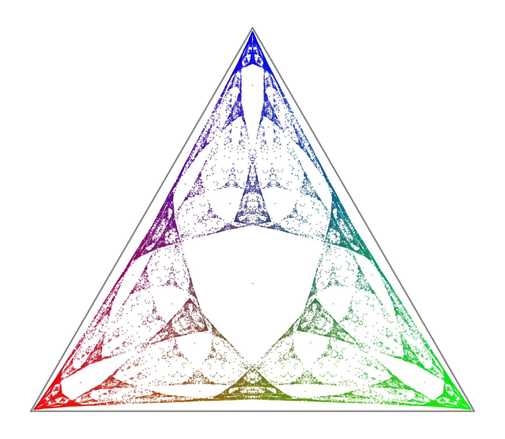
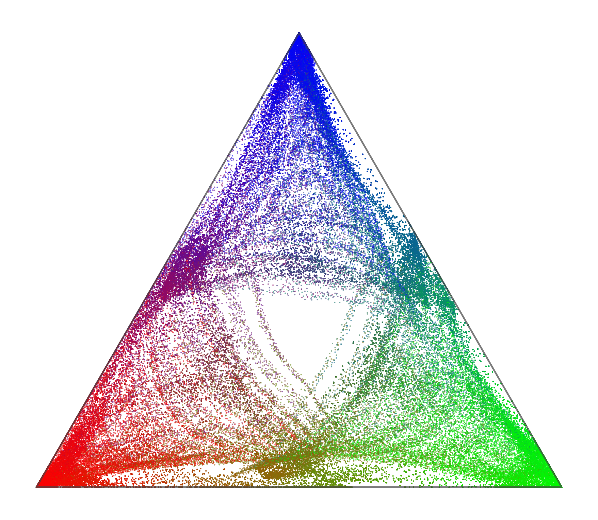
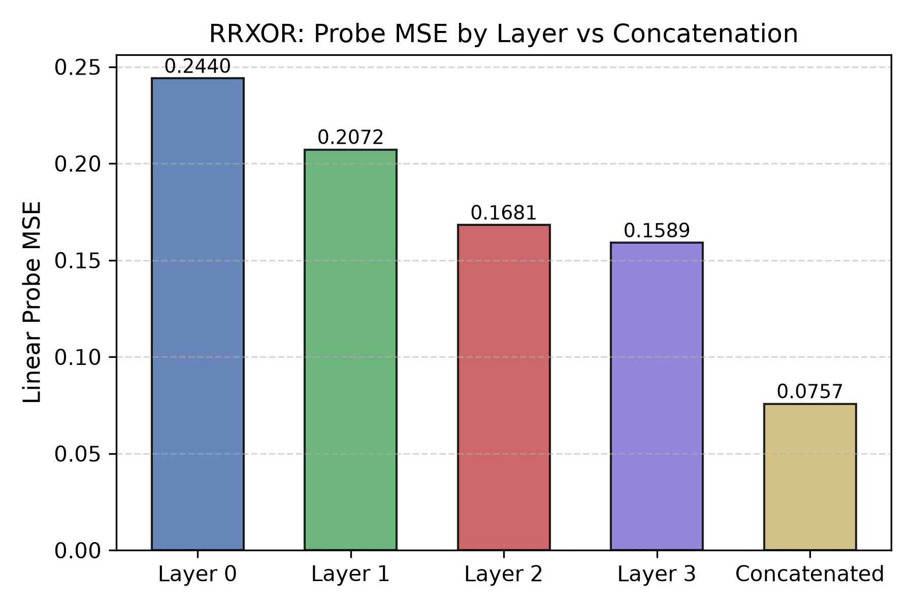
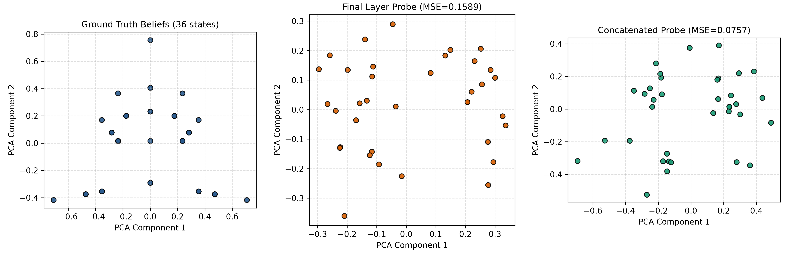
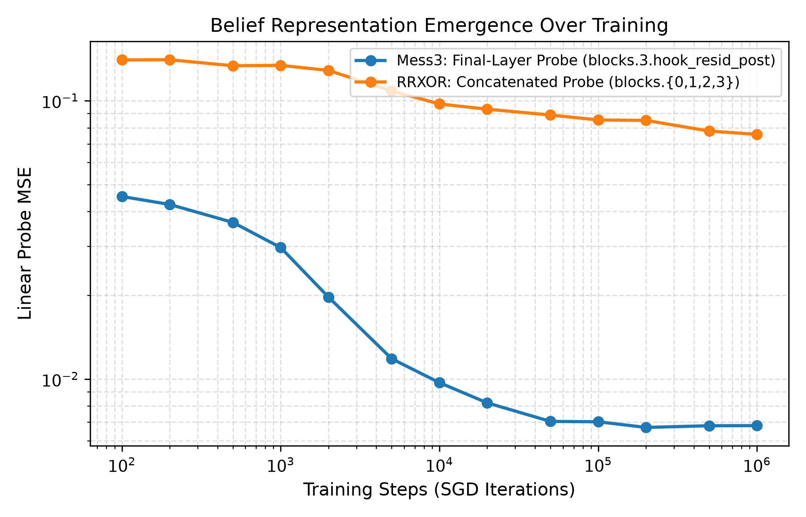
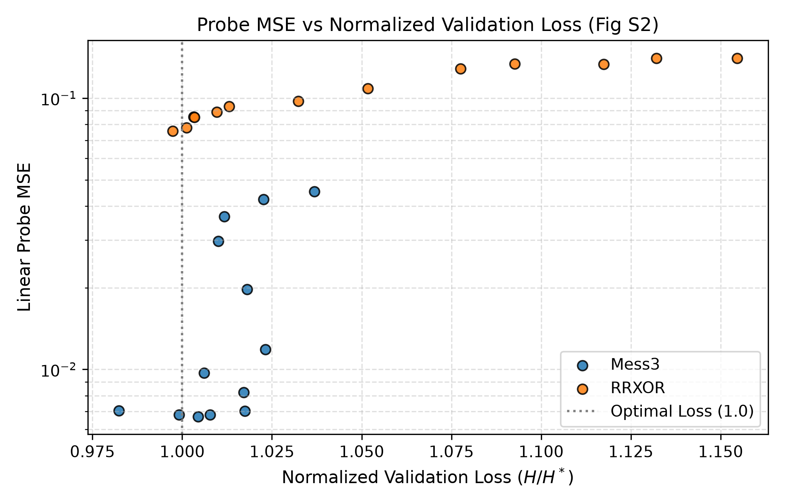
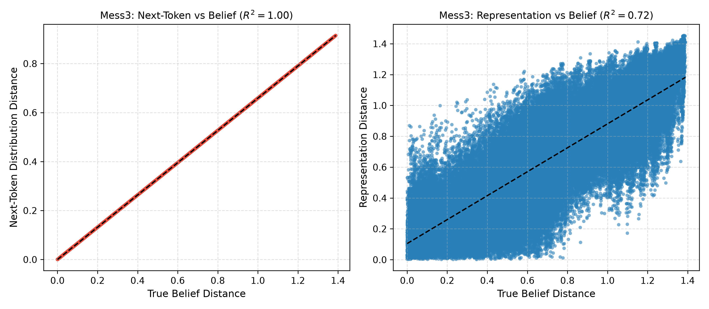
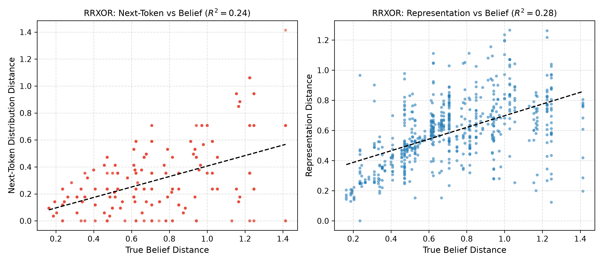

# simplexity: Transformers Represent Belief State Geometry in their Residual Stream

Clean-room reproduction of the core empirical findings in:

> **Transformers Represent Belief State Geometry in their Residual Stream**  
> Adam S. Shai, Sarah E. Marzen, Lucas Teixeira, Alexander Oldenziel, Paul M. Riechers  
> *Advances in Neural Information Processing Systems (NeurIPS 2024)*  
> [arXiv:2405.15943](https://arxiv.org/abs/2405.15943) | [OpenReview](https://openreview.net/forum?id=YIB7REL8UC)

---

## Overview & Empirical Reproduction Status

This repository provides an independent, clean-room implementation of the theoretical machinery, Hidden Markov Model (HMM) data generators, exact rational belief space dynamics, and probing analyses presented in Shai et al. (NeurIPS 2024).

### Status Summary
- [x] **Gate 1 (Stationary Distributions)**: Left eigenvectors verified with eigenvalue 1 for both Mess3 ($\pi = [1/3, 1/3, 1/3]$) and RRXOR ($\pi = [1/3, 1/6, 1/6, 1/6, 1/6]$).
- [x] **Gate 2 (Stochastic Matrices)**: Row sums equal 1.0 for both transition systems.
- [x] **Gate 3 (Reachable Beliefs)**: Exact rational arithmetic (`fractions.Fraction`) confirmed that RRXOR reaches **exactly 36 distinct belief states**, stabilizing at prefix length 6.
- [x] **Gate 4 (Ground Truth Geometry)**: Generated the 2-simplex fractal geometry of the Mess3 process for all prefixes up to length 10 (88,573 points), matching paper Figure 5B.
- [x] **Gate 5 (Optimal Loss Normalization)**: Derived and computed the exact 9-position finite-context expected conditional entropy ($H^* = 0.803518$ nats for Mess3; $H^* = 0.586501$ nats for RRXOR with position 0 analytically $\ln 2$).
- [x] **HookedTransformer & Environment**: TransformerLens 2.15.4 and PyTorch 2.15.0 verified in project-local `.venv`. Total download: 284.6 MiB (hard cap 5.0 GB).
- [x] **Full 1,000,000-Step Training**: Both models trained through the full 1,000,000 iterations sequentially on CPU (total runtime logged: 4.18 hours, 432 MB peak RAM, single-thread throughput 127–139 steps/s). Models entered a flat, noisy loss floor around theoretical optimal ($H / H^* \approx 1.000$):
  * **Mess3**: Step 1M checkpoint val norm = **1.0077** (raw loss = 0.80974 nats).
  * **RRXOR**: Step 1M checkpoint val norm = **0.9974** (raw loss = 0.58498 nats).
- [x] **Mess3 Headline (Fig 5C)**: **REPRODUCED**. Linear probe on final residual stream (`blocks.3.hook_resid_post`) on the full 590,490-sample dataset recovers the 2-simplex fractal with **Train MSE = 0.006804 ($R^2 = 0.9796$)** and **1,000x 20/80 CV Test MSE = 0.006809 ($\pm 0.000017$)**. 1,000x distinct-state shuffle control collapses with MSE = 0.267761 ($\pm 0.006479$, ~39x higher). *Honest gap: Paper Fig S1 caption reported 0.0004/0.0003; our measured MSE is ~0.0068, visually and statistically recovering the fractal.*
- [ ] **RRXOR Distributed Representation (Fig 7C/E)**: **PARTIALLY REPRODUCED / QUALIFIED**. Confirmed that linear probe Train MSE drops by **>52%** from Layer 3 (0.1589, $R^2 = 0.604$) to Concatenation (0.0757, $R^2 = 0.812$), and 1,000x 20/80 CV held-out Test MSE drops by **15%** (0.1711 $\to$ 0.1455). Concatenation lowers train-fit and held-out probe error relative to the final layer, but decoding above a matched shuffle null is not demonstrated. Matched CV shuffle null test MSE is 0.0875 ($\pm 0.0179$) for concat (and 0.1327 for Layer 3); and pairwise distance correlation across 35 states reaches $R^2 = 0.2762$ for probe predictions and $R^2 = 0.0871$ for activation centroids (vs paper-reported ~0.95; definition-dependent and comparability unresolved).
- [x] **Emergence Dynamics (Fig 6A/D & Fig S2)**: **REPRODUCED (Rapid refinement with plateau)**. Rapid early refinement with small non-monotonic ticks, then a plateau: Mess3 probe MSE drops from 0.045302 (100) to 0.006703 (200k), fluctuating between 0.006703 and 0.006804 through 1M; RRXOR concat MSE drops from 0.140212 (100) to 0.075728 (1M) with small non-monotonic ticks at steps 200 and 1,000.
- [x] **LayerNorm Robustness (Fig S1)**: **REPRODUCED**. Pre-LN Train MSE (0.006804) vs. Post-LN Train MSE (0.006391) confirms representation stability through the final LayerNorm.

---

## Headline Figures

### 1. Mess3 Ground Truth vs. Transformer Residual Representation (Figure 5B vs. 5C)
Left: Ground-truth belief state distribution across 88,573 prefixes ($\le 10$) in the 2-simplex.  
Right: Transformer final residual stream activations (`blocks.3.hook_resid_post`) projected through the fitted linear probe ($R^2 = 0.9796$).

| Ground Truth Belief Geometry (Fig 5B) | Learned Residual Stream Geometry (Fig 5C) |
| :---: | :---: |
|  |  |

### 2. RRXOR Layer-wise vs. Concatenated Representation (Figure 7C & 7E)
Left: Linear probe MSE across network layers (MSE drops from 0.1589 in Layer 3 to 0.0757 in Concatenation).  
Right: 2D PCA projection of the 36 distinct belief states comparing Ground Truth vs. Final Layer vs. Concatenated Representation.

| Layer-wise Probe MSE (Fig 7C) | 36 Belief States Recovery (Fig 7E) |
| :---: | :---: |
|  |  |

### 3. Emergence Over Training & Loss Normalization (Figure 6 & Figure S2)
Left: Probe MSE emergence over 1,000,000 training iterations (log-log scale).  
Right: Probe MSE vs. Normalized Validation Loss ($H / H^*$).

| Probe MSE Emergence (Fig 6) | MSE vs Normalized Loss (Fig S2) |
| :---: | :---: |
|  |  |

### 4. Pairwise Distance Correlations (Figure 7D)
Pairwise Euclidean distances between true belief states vs. probe-predicted representation distances and next-token distribution distances:

| Mess3 Pairwise Distances | RRXOR Pairwise Distances |
| :---: | :---: |
|  |  |

---

## Repository Structure

```
simplexity/
├── .github/workflows/ci.yml       # Minimal CPU CI testing suite
├── figures/                       # Generated reproduction figures (from 1M runs)
│   ├── GT_mess3.png               # Mess3 ground-truth 2-simplex fractal (Gate 4)
│   ├── fig5c_mess3_repr.png       # Mess3 residual stream representation (Fig 5C)
│   ├── fig6_emergence.png         # Representation emergence over training (Fig 6)
│   ├── fig7c_rrxor_layers.png     # RRXOR layer-wise probe MSE bar chart (Fig 7C)
│   ├── fig7d_mess3_distances.png  # Mess3 pairwise distance correlation (Fig 7D)
│   ├── fig7d_rrxor_distances.png  # RRXOR pairwise distance correlation (Fig 7D)
│   ├── fig7e_rrxor_concat.png     # RRXOR 36 belief states PCA projection (Fig 7E)
│   ├── figS2_normalized_loss.png  # Probe MSE vs normalized validation loss (Fig S2)
│   └── pilot_20k/                 # Preserved pilot-stage figures (20k steps)
├── outputs/                       # Summary JSON metrics (committed)
│   ├── 1M/                        # 1M run summary metrics and emergence series
│   │   ├── Mess3_metrics.json
│   │   ├── RRXOR_metrics.json
│   │   ├── emergence_summary.json
│   │   ├── probe_results_summary.json
│   │   ├── rrxor_layer_emergence.json
│   │   ├── activation_centroid_distances.json
│   │   └── paired_normalized_null.json
│   └── pilot_20k/                 # 20k pilot run summary metrics
├── scripts/
│   ├── run_probes.py              # Complete probe evaluation & figure generator
│   ├── train_all.py               # Sequential multi-process training orchestrator
│   ├── compute_part2_analyses.py  # Layer emergence & matched CV shuffle null
│   └── compute_paired_normalized_null.py # 1000x paired normalized CV shuffle null
├── src/simplexity/                # Core Python package
│   ├── belief.py                  # Rational & float belief update machinery
│   ├── cli.py                     # Unified CLI entrypoint
│   ├── entropy.py                 # Theoretical optimal loss derivations (Gate 5)
│   ├── model.py                   # HookedTransformer & SimplexityTransformer architectures
│   ├── processes.py               # Mess3 and RRXOR HMM generators (App A.3)
│   ├── probes.py                  # Linear regression probes & statistical controls
│   ├── train.py                   # SGD training loop, RNG checkpointing, pilot
│   └── visualization.py           # 2-simplex ternary coordinates & plotting
├── tests/                         # Comprehensive unit & integration tests
│   └── test_resume.py             # Bit-exact checkpoint resumption test
├── CITATION.cff                   # Citation metadata
├── LICENSE                        # MIT License
├── paper_vs_study.md              # Side-by-side comparison & explicit deviations
├── REPRODUCTION_REPORT.md         # Detailed reproduction report & audit
├── SHA256SUMS.txt                 # Artifact SHA-256 provenance manifest
└── what_this_taught_me.md         # Factual findings & notes
```

---

## Quickstart & Replication

### 1. Environment Setup
```bash
# Create local virtual environment
uv venv --python 3.11 .venv
source .venv/bin/activate

# Install dependencies (CPU torch, transformer-lens, numpy, scipy, matplotlib, pytest)
uv pip install -e . "transformer-lens>=1.14.0,<3.0.0"
```

### 2. Run Pre-training Gates
```bash
python -m simplexity.cli run-gates
```

### 3. Run Test Suite
```bash
pytest
```

### 4. Train Models
```bash
# Train both processes sequentially for 1,000,000 steps on CPU (~4.2 hours total):
python scripts/train_all.py --steps 1000000 --process both

# Or train individual processes via the CLI:
python -m simplexity.cli train --process Mess3 --steps 1000000
python -m simplexity.cli train --process RRXOR --steps 1000000
```

### 5. Run Probe Analysis & Generate Figures
```bash
python scripts/run_probes.py --checkpoints-dir checkpoints/1M --output-dir outputs/1M --figures-dir figures
python scripts/compute_part2_analyses.py
```

---

## Citation

```bibtex
@inproceedings{shai2024transformers,
  title={Transformers Represent Belief State Geometry in their Residual Stream},
  author={Shai, Adam S and Marzen, Sarah E and Teixeira, Lucas and Oldenziel, Alexander and Riechers, Paul M},
  booktitle={Advances in Neural Information Processing Systems (NeurIPS 2024)},
  year={2024},
  url={https://arxiv.org/abs/2405.15943}
}
```
